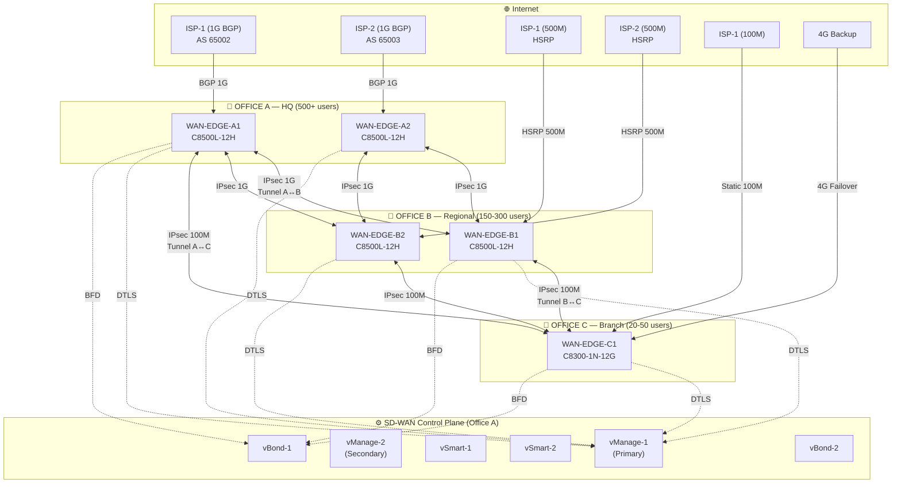
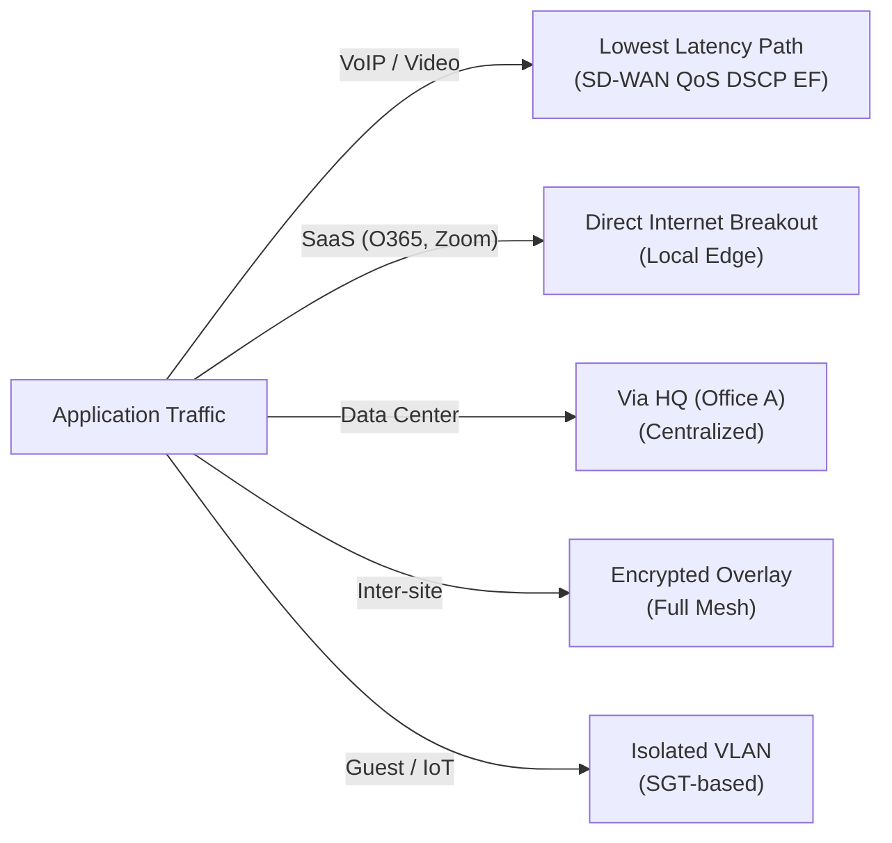

# Global WAN Topology — SD-WAN Fabric

## Overview

## Tunnel Matrix

| From | To | Bandwidth | Encryption | Purpose |
|------|-----|-----------|------------|---------|
| A1 | B1 | 1 Gbps | AES-256-GCM | Primary inter-site |
| A1 | B2 | 1 Gbps | AES-256-GCM | Redundant inter-site |
| A2 | B1 | 1 Gbps | AES-256-GCM | Redundant inter-site |
| A2 | B2 | 1 Gbps | AES-256-GCM | Primary inter-site |
| A1 | C1 | 100 Mbps | AES-256-GCM | HQ to Branch |
| B1 | C1 | 100 Mbps | AES-256-GCM | Regional to Branch (backup) |
| B2 | C1 | 100 Mbps | AES-256-GCM | Regional to Branch (backup) |

## App-Aware Routing Policy

