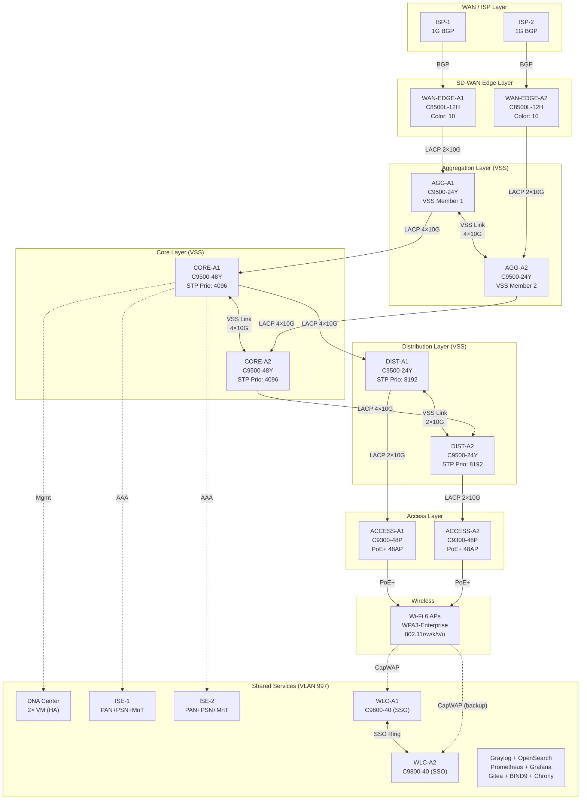
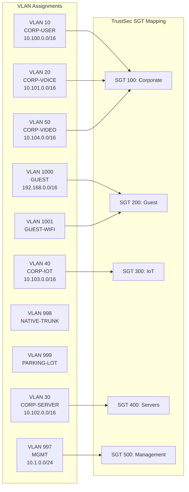

# Office A (HQ) — Full Fabric Network Diagram

## Layered Architecture

## Redundancy Summary

| Layer | Redundancy Type | Failover Time |
|-------|----------------|---------------|
| WAN (ISP) | BGP Multihoming + ECMP | <1s (BGP convergence) |
| SD-WAN Edge | Dual vEdge, dual ISP | <1s (tunnel failover) |
| Aggregation | VSS (Virtual Switching System) | 0s (dual-active) |
| Core | VSS (Virtual Switching System) | 0s (dual-active) |
| Distribution | VSS (Virtual Switching System) | 0s (dual-active) |
| Access | Dual uplinks (LACP) | <50ms (LACP) |
| WLC | SSO (Stateful Switchover) | <1s |
| ISE | 2× PAN + PSN (full HA) | <2s |
| DNA Center | Active/Standby VM | <30s |
| Logging | Dual Graylog + Dual OpenSearch | 0s (active/standby) |

## VLAN & Subnet Map

