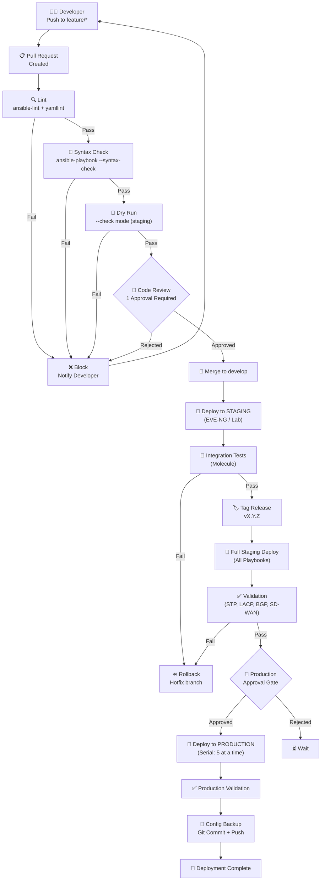
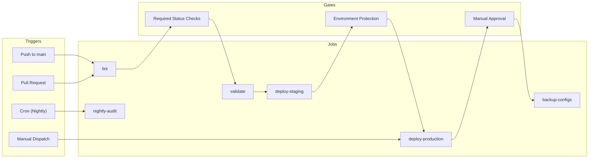

# CI/CD Pipeline — GitHub Actions

## Full Pipeline Flow

## GitHub Actions Workflow Matrix

## Environment Protection Rules

| Environment | Protection | Approval Required |
|-------------|-----------|-------------------|
| `staging` | Required status checks: `lint`, `validate` | Auto (on merge to develop) |
| `production` | Required status checks + environment | **2 reviewers** from CODEOWNERS |
| `emergency` | No checks (hotfix) | 1 reviewer + CTO |   
